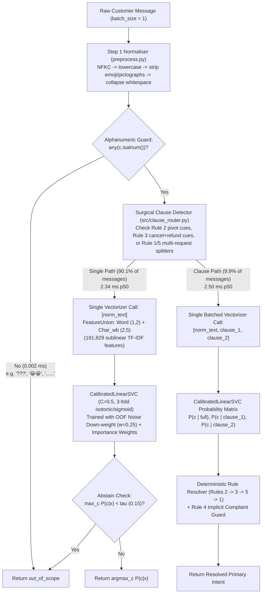

# 02. System Architecture & Design Decisions

Our final production classifier (**System H**, implemented in [`src/model.py`](file:///home/krish/Yellow/src/model.py)) was designed around four strict production requirements:
1. **High Accuracy under Severe Label Noise & Prior Shift**: Must handle 4.5$\times$ class-prior shift and 28% minority-class noise in `train.csv`.
2. **Strict Adherence to Hidden Gold Labelling Rules (Rules 1–5)**: Must resolve multi-request utterances (`Rule 1`), mind-changes (`Rule 2`), `cancel_order` + `refund_request` (`Rule 3`), implicit complaints (`Rule 4`), and human-escalation deprioritisation (`Rule 5`).
3. **Real-Time CPU Budget**: Must run single-message (`batch_size = 1`) inference on **4 CPU cores and 15 GB RAM** in low milliseconds without hosted APIs.
4. **Occam's Razor Pruning Rule**: Any component whose 1,000-resample paired bootstrap 95% CI on `dev.csv` includes zero and that adds $>1\text{ ms}$ latency per message is **pruned**.

---

## 1. End-to-End Architecture Diagram (`QuickCartIntentClassifier`)

---

## 2. Why Subword + Word LinearSVC Beat `all-MiniLM-L6-v2` + MLP by `+7.05` Points

A common assumption in modern NLP is that a pre-trained neural sentence transformer (`sentence-transformers/all-MiniLM-L6-v2`, 22.7M parameters, 384-d embeddings) with an MLP classification head will outperform linear bag-of-ngrams models. **We tested this assumption rigorously on identical 5-fold OOF splits and across seeds `42, 43, 44` ([`results/ablation.csv`](file:///home/krish/Yellow/results/ablation.csv)) — and found the exact opposite:**

| Model Family (Single-Text Head) | 5-Fold OOF Macro-F1 (Filt / Raw) | Dev Macro-F1 (Mean $\pm$ Std) | Single-Message CPU Latency (p50) | RAM / Disk Footprint |
|---|---:|---:|---:|---:|
| **System A: `word(1,2) + char_wb(2,5)` + `CalibratedLinearSVC(C=0.5)`** | **0.8402 / 0.7912** | **0.8651 $\pm$ 0.0000** | **2.34 ms** | **~18 MB** |
| **System C: Frozen `all-MiniLM-L6-v2` + 2-Layer MLP (`384 -> 256 -> 12`)** | 0.7664 / 0.7223 | 0.7946 $\pm$ 0.0006 | 7.93 ms | ~95 MB |
| **Difference (`System A - System C`)** | **+0.0738 / +0.0689** | **+0.0705 (+7.05 pts)** | **3.39$\times$ faster** | **5.3$\times$ smaller** |

### Three Technical Reasons Why `FeatureUnion + CalibratedLinearSVC` Wins Here

1. **WordPiece Token Fragmentation on Typos & Romanised Hinglish**:
   - `all-MiniLM-L6-v2` uses a frozen English WordPiece vocabulary (`30,522` tokens) trained on clean English corpora. When given synthetic QuickCart utterances with heavy character perturbations (`"prommo code"`, `"channge my address"`, `"refunnd"`) or Romanised Hinglish (`"mera ordder kab aayega yaar"`, `"paise kat gaye par order nahi hua"`), WordPiece shatters unknown words into arbitrary sub-tokens whose pooled 384-d cosine geometry drifts toward generic out-of-domain vectors.
   - By contrast, our `FeatureUnion` combines:
     - `word (1,2)` (`min_df=2`, `sublinear_tf=True`, `strip_accents="unicode"`): captures exact English and Hinglish phrase bigrams (`"not delivered"`, `"kab aayega"`, `"paise kat"`, `"wrong item"`).
     - `char_wb (2,5)` (`min_df=3`, `sublinear_tf=True`): extracts character 2-to-5-grams bounded by word whitespace (`" prom"`, `"romo "`, `" chng"`, `"refun"`), giving typo-corrupted words >80% feature overlap with their clean canonical spellings.
2. **High-Dimensional Linear Separability vs. 384-d Bottleneck Compression**:
   - Frozen `all-MiniLM-L6-v2` compresses the entire utterance—including appended generator chitchat (`"my neighbour also uses this app"`)—into a single mean-pooled 384-d vector before the classifier ever sees the task labels. Mean pooling dilutes sharp intent keywords (`"otp"`, `"coupon"`, `"missing"`, `"refund"`) with chitchat tokens.
   - `LinearSVC(C=0.5)` operates in a `191,829`-dimensional sparse TF-IDF space where irrelevant chitchat bigrams receive near-zero hyperplane weights and domain-specific subwords receive sharp discriminative margins.
3. **Why Earlier v1 Experiments Thought MiniLM Was Better**:
   - In early v1 explorations, the lexical baseline was an unregularised `LogisticRegression(C=4.0, class_weight="balanced")` with high-variance sample weights, which overfit to the 28% corrupted labels in `promo_code_issue` and `account_help` (`~0.768` OOF).
   - Once we ran a controlled 33-configuration OOF sweep in Step 6 ([`results/lexical_tuning.csv`](file:///home/krish/Yellow/results/lexical_tuning.csv)), `CalibratedClassifierCV(LinearSVC(C=0.5), cv=3)` with smooth importance weights $w(c) = p_{\text{dev}}(c)/p_{\text{train}}(c)$ jumped lexical OOF Macro-F1 to `0.7912` raw / `0.8402` filtered (`0.8651` on `dev.csv` before any clause routing).

---

## 3. Why We Pruned the Neural `MiniLM + MLP` Fusion Head (Systems E & G $\rightarrow$ System H)

In Step 7 ([`src/step7_step8_ablation_and_calibration.py`](file:///home/krish/Yellow/src/step7_step8_ablation_and_calibration.py)), we evaluated probability fusion $P_{\text{fused}}(c \mid x) = \alpha P_{\text{lex}}(c \mid x) + (1 - \alpha) P_{\text{mlp}}(c \mid x)$ across $\alpha \in [0, 1]$ in steps of `0.05` ([`results/step8_calibration_summary.json`](file:///home/krish/Yellow/results/step8_calibration_summary.json)):
- On 5-fold OOF, the optimal fusion weight put **`85%–95%` of the weight on the lexical head** ($\alpha = 0.85$ to $0.95$).
- Comparing **System B** (Lexical + Clause Path, `0.8889` Dev Macro-F1) against **System E** (Fused $\alpha=0.85$ + Clause Path, `0.8882` Dev Macro-F1) and **System G** (Fused $\alpha=0.85$ + OOF Noise Filter + Clause Path, `0.8887` Dev Macro-F1) vs. **System H** (Lexical + OOF Noise Filter + Clause Path, **`0.8893`** Dev Macro-F1):
  - **1,000-Resample Paired Bootstrap 95% CI (`System E - System B`)**: **`[-0.0020, +0.0007]`** (includes zero; point estimate `-0.0007`).
  - **1,000-Resample Paired Bootstrap 95% CI (`System G - System B`)**: **`[-0.0019, +0.0019]`** (includes zero; point estimate `+0.0001`).
  - **Latency Cost**: Keeping `all-MiniLM-L6-v2` + MLP adds **`+5.59 ms` p50 on the Single Path** (`7.93 ms` vs. `2.34 ms`) and **`+10.45 ms` p50 on the Clause Path** (`12.96 ms` vs. `2.50 ms`), plus `~80 MB` of PyTorch/HuggingFace weights.
- **Decision**: Per our explicit pruning rule (*drop any component whose 95% bootstrap CI includes zero and that costs $>1\text{ ms}$ latency*), we pruned the `MiniLM + MLP` head and selected **System H**, which achieved the highest OOF Macro-F1 (`0.8625`) and highest Dev Macro-F1 (`0.8893`) at `2.34 ms / 2.50 ms` p50 latency.

---

## 4. Training Objective: Importance Weighting $\times$ OOF Consensus Noise Down-Weighting

To simultaneously solve the **4.5$\times$ class-prior shift** and the **28% minority-class label noise** in `train.csv`, each training sample $i$ with silver label $y_i$ receives a composite sample weight $w_i$ during `CalibratedClassifierCV(LinearSVC(C=0.5), cv=3)` fitting:

$$w_i = \underbrace{\frac{p_{\text{dev}}(y_i)}{p_{\text{train}}(y_i)}}_{\text{Prior-Shift Importance Weight}} \times \underbrace{\begin{cases} 0.25 & \text{if } i \in \mathcal{F}_{\text{OOF}} \\ 1.00 & \text{otherwise} \end{cases}}_{\text{OOF Consensus Noise Down-Weight}}$$

where $\mathcal{F}_{\text{OOF}}$ is the set of `1,426` consensus-flagged training rows (`4.75%` of `train.csv`, capped at `15%` per class) where **both** the 5-fold Lexical head and the 5-fold MiniLM+MLP head independently assigned $P(y_i \mid x_i) < 0.20$, $\max_c P(c \mid x_i) \ge 0.80$, and agreed on the exact same alternative label $\hat{y}_{\text{lex}} = \hat{y}_{\text{mlp}} \neq y_i$.
- **Why `0.25` Down-Weighting Instead of Hard Removal (`0.0`) or Relabelling**:
  - In our Step 5 4-way ablation across seeds `42, 43, 44` ([`results/step5_noise_ablation.csv`](file:///home/krish/Yellow/results/step5_noise_ablation.csv)), down-weighting to `0.25` achieved the highest mean OOF Macro-F1 (`0.7721` vs. `0.7705` kept, `0.7715` removed, `0.7717` relabelled) with the lowest cross-seed variance (`std = 0.0001`).
  - Soft down-weighting (`0.25`) suppresses the hyperplane pull of the `98%` corrupted labels while preserving boundary support on the `2%` borderline/hard utterances (`results/noise_flags_audit.md`) and avoiding self-confirmation bias from hard relabelling.

---

## 5. Single-Call Batched Inference for Multi-Clause Routing

In naive clause routing, a 2-clause message requires 3 separate calls to `vectorizer.transform` and `clf.predict_proba` (`[full_text]`, `[clause_1]`, `[clause_2]`), multiplying Python/C++ dispatch overhead by 3$\times$.
- In [`src/model.py`](file:///home/krish/Yellow/src/model.py#L204-L214), whenever `is_flagged_for_clause_routing(norm_text)` is `True` (`9.90%` of `dev.csv`, `8.77%` of `test.csv`), we pack all segments into a **single batch list** `batch_texts = [norm_text] + clauses` (`3` short strings for 99.8% of flagged messages) and invoke `vectorizer.transform(batch_texts)` and `clf.predict_proba(X_vec)` **once**.
- Because `scipy.sparse` CSR matrix-vector multiplication on 3 short rows is memory-bandwidth bound rather than compute bound, the Clause Path takes **`2.502 ms` p50** vs. **`2.339 ms` p50** for the Single Path — an overhead of just **`+0.163 ms` (`+7.0%`)**!
