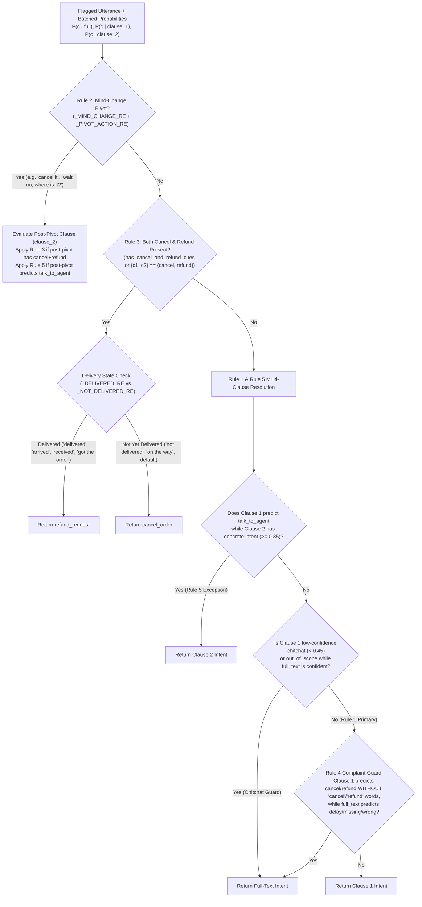

# 03. Implementation Details & Surgical Rule Engine

This document walks through the exact implementation of our three core production modules—[`preprocess.py`](file:///home/krish/Yellow/preprocess.py), [`src/clause_router.py`](file:///home/krish/Yellow/src/clause_router.py), and [`src/model.py`](file:///home/krish/Yellow/src/model.py)—and shows how our empirical audits fixed the failure modes of earlier iterations.

---

## 1. Text Normalisation & Non-Alphanumeric Guard ([`preprocess.py`](file:///home/krish/Yellow/preprocess.py))

The single function [`preprocess_and_guard(text)`](file:///home/krish/Yellow/preprocess.py#L51-L65) is used identically at training and inference time:
1. **Unicode NFKC Normalisation**: `unicodedata.normalize("NFKC", text)` canonicalises compatibility characters and full-width punctuation.
2. **Lowercasing**: `.lower()`.
3. **Emoji, Pictograph & Variation Selector Stripping**:
   - `_EMOJI_RE` strips Supplementary Multilingual Plane emojis (`U+1F000–U+1FAFF`), Miscellaneous Symbols (`U+2600–U+26FF`), Dingbats (`U+2700–U+27BF`), Variation Selectors (`U+FE00–U+FE0F`), and Zero-Width Joiners (`U+200D`), replacing them with a space so adjacent words do not concatenate.
   - A secondary pass removes any remaining character with Unicode category `So` (Symbol, other) or `Cs` (Surrogate).
4. **Whitespace Collapse**: `_WS_RE.sub(" ", text).strip()`.
5. **Post-Normalisation Alphanumeric Guard**:
   - Executed **after** normalisation and emoji stripping:
     ```python
     if not norm or not any(ch.isalnum() for ch in norm):
         return norm, True, "out_of_scope"
     ```
   - **Why order matters**: An input like `'😀😀'` (`t01946`) is non-empty before emoji stripping (`len == 2`), so a pre-normalisation empty check would pass it to the vectorizer where it produces an all-zero TF-IDF vector. Running the guard *after* emoji stripping deterministically routes `'😀😀'`, `'???'` (`t01727`), `'...?'` (`t02057`), and `'......'` (`dev_01986`) to `out_of_scope` in `0.002 ms`.

---

## 2. How Cue-Level Auditing Fixed the Clause Splitter ([`src/clause_router.py`](file:///home/krish/Yellow/src/clause_router.py))

In our earlier System v1.1 (`src/step2_error_analysis.py`), multi-request utterances scored only **`0.7190` Macro-F1** on `dev.csv` (`547` rows) and long utterances (`25+` tokens, `194` rows) scored only **`0.7777` Macro-F1**.

In Step 5, we audited 100 candidate multi-clause rows stratified across 4 cue categories (`25` rows each: `"but"`/`"par"`/`"lekin"`, `"also"`, `"and"`/`"plus"`, and `"instead"`/`"actually"`/`"wait"`, saved in [`results/train_rule_repair_sample100.csv`](file:///home/krish/Yellow/results/train_rule_repair_sample100.csv) and [`results/noise_flags_audit.md`](file:///home/krish/Yellow/results/noise_flags_audit.md)). That audit uncovered **three severe bugs** in the v1.1 clause splitter:

### Bug 1: Contrastive `"but"` / `"par"` / `"lekin"` (`0 / 25 = 0.0%` Valid Multi-Requests!)
- **What v1.1 did**: Included `\bbut\b`, `\bpar\b`, and `\blekin\b` in the multi-request split regex and kept the **first** clause per Rule 1.
- **What the 25-row audit showed**: **Zero out of 25 (`0%`)** `"but"` rows in QuickCart were true multi-request utterances! Instead, `"but"` appeared in two single-intent structures:
  1. *Setup fact + `"but"` + actual problem*:
     - `"I ordered 3 things but only got 2"` (`missing_item`) $\rightarrow$ Clause 1 `"I ordered 3 things"` has **no complaint** and misclassifies as `order_status` or `out_of_scope`!
     - `"Delivered but my burger is absent"` (`missing_item`) $\rightarrow$ Clause 1 `"Delivered"` loses the entire missing-item complaint!
     - `"Payment went through from my bank but order failed"` (`payment_failed`) $\rightarrow$ Clause 1 `"Payment went through from my bank"` loses `"order failed"`!
  2. *Polite filler + `"but"` + actual request*:
     - `"I tried calling earlier but the line was busy, where is my order?"` (`order_status`) $\rightarrow$ Clause 1 `"I tried calling earlier"` misclassifies as `talk_to_agent`!
- **The Fix**: Removed `"but"`, `"par"`, and `"lekin"` completely from `_MULTI_SPLIT_RE`. Now the full sentence is scored intact by the classifier, preserving both the setup and the problem.

### Bug 2: Bare `"also"` Matching Chitchat Filler (`9 / 25 = 36.0%` False Splits)
- **What v1.1 did**: Split on bare `\balso\b`.
- **What the 25-row audit showed**: `9/25` (`36%`) of `"also"` rows were synthetic generator chitchat appended to a single request:
  - `"my neighbour also uses this app, my order is late"` $\rightarrow$ Splitting on bare `"also"` extracted `"my neighbour"` as Clause 1!
  - `"my wifi is also acting up, please cancel my order"` $\rightarrow$ Extracted `"my wifi is"` as Clause 1!
- **The Fix**: Restricted `"also"` splitting in [`_MULTI_SPLIT_RE`](file:///home/krish/Yellow/src/clause_router.py#L46-L52) to punctuated or conjunction-paired discourse markers: `(?:,\s*|\band\s+)also\b` and `\balso\s*,`. In genuine multi-request utterances (`"where is my order, also I want a refund"` or `"cancel my order and also refund me"`), `"also"` is always preceded by a comma/conjunction or followed by a comma.

### Bug 3: Bare `"instead"` & `"actually"` Matching Single-Intent Phrases (`6 / 25 = 24.0%` False Splits)
- **What v1.1 did**: Treated bare `\binstead\b` and `\bactually\b` as Rule 2 mind-change pivots.
- **What the 25-row audit showed**:
  - `"I got milk instead of curd"` (`wrong_item`) matched `\binstead\b` and kept `"of curd"`!
  - `"get me someone who can actually help"` (`talk_to_agent`) matched `\bactually\b` and kept `"help"`!
- **The Fix**:
  - Replaced bare `"instead"` with `\binstead\b(?!\s+of\b)` (negative lookahead for `"of"`) and required an action verb (`cancel`, `refund`, `change`, `update`, `deliver`, `send`, `give`, `want`, `need`, `where`, `status`, `check`, `connect`, `talk`, `speak`, `agent`, `human`) in the post-pivot clause via [`_PIVOT_ACTION_RE`](file:///home/krish/Yellow/src/clause_router.py#L36-L40).
  - Required `"actually"` to be paired with a reversal or discourse cue (`actually never mind`, `actually no`, `actually wait`, `actually forget`, `actually don't`, or comma-bounded `, actually `) in [`_MIND_CHANGE_RE`](file:///home/krish/Yellow/src/clause_router.py#L19-L33).

---

## 3. Deterministic Execution of Labelling Rules 1–5

When [`resolve_clause_predictions(norm_text, full_probs, clause_probs_list, clauses, intents)`](file:///home/krish/Yellow/src/clause_router.py#L140-L221) runs on a flagged utterance (`9.90%` of `dev.csv`), it applies the 5 hidden gold rules in strict precedence order:



### Key Safeguards Inside `resolve_clause_predictions`:
1. **Rule 2 (`extract_post_pivot_clause`)**: If a mind-change pivot is present (`"cancel my order — wait no, where is it?"`), everything before the last reversal marker is discarded. If the post-pivot clause itself contains both cancel and refund cues, Rule 3 resolves it; if the post-pivot clause predicts `talk_to_agent` while the full text strongly signals a concrete request (`>= 0.50`), Rule 5 overrides `talk_to_agent`.
2. **Rule 3 (`resolve_cancel_refund`)**: Triggered either when the utterance explicitly contains both cancel and refund lexical stems (`has_cancel_and_refund_cues`) and the top predicted intents are in `{cancel_order, refund_request}`, or when Clause 1 and Clause 2 split directly into `{cancel_order, refund_request}`. Checks `_NOT_DELIVERED_RE` (`not delivered`, `hasn't arrived`, `on the way`, `still waiting`, `yet to arrive`, `rider is`, `before it`) vs. `_DELIVERED_RE` (`delivered`, `arrived`, `received`, `got the`, `came cold`, `was cold`, `after delivery`), defaulting to `cancel_order` when undelivered.
3. **Rule 5 (`talk_to_agent` Deprioritisation)**: If Clause 1 predicts `talk_to_agent` (`"connect me to an agent and also check my refund"`) and any subsequent clause predicts a concrete in-scope intent with probability $\ge 0.35$, the concrete request wins.
4. **Rule 4 Implicit Complaint Guard**: If a split clause predicts `cancel_order` or `refund_request` even though the words `"cancel"` or `"refund"`/`"money back"` do not appear anywhere in the utterance, and the full utterance predicts a Rule 4 problem intent (`delivery_delay`, `missing_item`, `wrong_item`), the resolver falls back to the full utterance's Rule 4 prediction.
