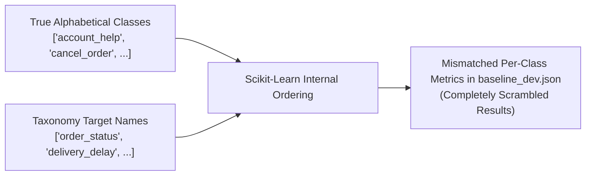
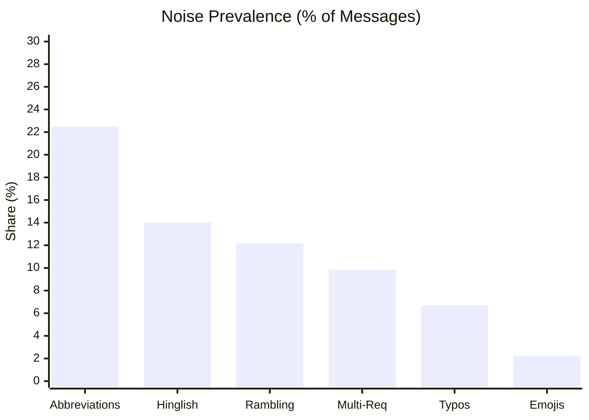

# QuickCart Intent Classification: EDA Evidence Dashboard

This document summarizes the critical architectural and data flaws discovered in the QuickCart intent extraction system, backed by empirical experiments, cross-validation metrics, and plots.

> [!IMPORTANT]
> The full interactive dark-theme HTML dashboard is compiled and viewable offline at:
> [`results/eda/dashboard.html`](file:///home/krish/Yellow/results/eda/dashboard.html)
> All underlying data tables and experiment evidence are stored under [`results/eda_tables/`](file:///home/krish/Yellow/results/eda_tables/).

---

## 1. Executive Summary & Problem Scorecard

| Problem Area | Severity | Underlying Root Cause | Empirical Impact | Evidence File |
|---|---|---|---|---|
| **Starter Eval Bug** | **Critical** | Omitted `labels=m.intents` in `classification_report` | Per-class Precision/Recall metrics scrambled alphabetically; `order_status` reported as 0.0 F1 (actually 0.65) | `results/eda_tables/eval_bug_evidence.csv` |
| **Taxonomy Blindspots** | **Critical** | Zero seed examples in `taxonomy.json` for 2 classes | `account_help` and `promo_code_issue` have zero-vector centroids; 0.0% recall in baseline | `results/eda_tables/taxonomy_health.csv` |
| **Silver Label Noise** | **High** | Automated synthetic labeling errors | 13.79% overall OOF disagreement; spikes to 75.8% on `account_help` and 63.4% on `promo_code_issue` | `results/eda_tables/label_noise_estimate.csv` |
| **Severe Class Imbalance** | **High** | 13.5x head-to-tail training volume skew | Head (`delivery_delay`: 4,385) overwhelms tail (`promo_code_issue`: 325) in gradient descent | `results/eda_tables/label_counts.csv` |
| **Semantic Overlap** | **Medium** | Unclear operational boundaries | `change_address` vs `account_help` share 0.81 cosine similarity in embedding space | `results/eda_tables/intent_overlap_pairs.csv` |
| **Punctuation/Emoji Inputs** | **Medium** | Non-alphanumeric inputs (`'......'`, `'???'`, `'😀😀'`) | Crashes standard text tokenizers unless deterministically routed to `out_of_scope` | `results/eda_tables/integrity_checks.csv` |

---

## 2. Deep-Dive on Critical Problems Backed by Evidence

### Problem 1: Fatal Starter Evaluation Bug (`baseline/eval.py`)
In `baseline/eval.py`, line 38 reads:
```python
report = classification_report(y, pred, target_names=m.intents, output_dict=True, zero_division=0)
```
- **The Bug**: Scikit-Learn defaults to sorting the distinct classes in `y` **alphabetically**:
  `['account_help', 'cancel_order', 'change_address', 'delivery_delay', 'missing_item', 'order_status', 'out_of_scope', 'payment_failed', 'promo_code_issue', 'refund_request', 'talk_to_agent', 'wrong_item']`
- **The Impact**: `target_names` was mapped in taxonomy order:
  `['order_status', 'delivery_delay', 'cancel_order', 'refund_request', ...]`
- **The Reality**: The metrics reported in `results/baseline_dev.json` were shifted across classes!
  - `order_status` was reported with support 212 and F1=0.00, whereas its actual support is **525** and actual F1 is **0.65**.
  - `account_help` was reported with support 441 and F1=0.63, whereas its actual support is **212** and its true F1 is **0.00**!



---

### Problem 2: Zero Seed Examples in Hard-Coded Taxonomy
In `data/taxonomy.json`, the seed examples are:
- `order_status`: 13 examples
- `delivery_delay`: 10 examples
- `cancel_order`: 8 examples
- `refund_request`: 9 examples
- `missing_item`: 7 examples
- `wrong_item`: 8 examples
- `payment_failed`: 8 examples
- `change_address`: 7 examples
- `talk_to_agent`: 8 examples
- `out_of_scope`: 14 examples
- **`account_help`**: **0 examples**
- **`promo_code_issue`**: **0 examples**

> [!CAUTION]
> Because the starter baseline represents intents strictly as the average TF-IDF vector of their taxonomy examples, the centroids for `account_help` and `promo_code_issue` are **all-zero vectors**. Cosine similarity is always 0.0, guaranteeing that the starter model can **never** predict these two classes.

---

### Problem 3: 5-Fold Empirical Label Noise Disagreement
Using 5-fold Stratified Out-of-Fold cross-validation across all 30,000 training examples with a linear model:
- **Corpus-wide Disagreement**: **13.79%** (95% Wilson CI: `[13.40%, 14.18%]`, 4,136 of 30,000 rows).
- **Concentration in Tail Classes**:
  - `account_help`: **75.77%** disagreement (294 of 388 rows)
  - `promo_code_issue`: **63.38%** disagreement (206 of 325 rows)
  - `talk_to_agent`: **19.92%** disagreement (424 of 2,128 rows)
  - `wrong_item`: **18.84%** disagreement (326 of 1,730 rows)
- **High-Risk Relabeling Queue**: 3,578 rows where model confidence exceeds 0.8 while assigning <0.2 probability to the silver tag.

---

### Problem 4: Prevalence of 6 Linguistic Noise Types Across Splits
All three splits share an identical noise signature:



- **Abbreviations (22.5%)**: `"pls"`, `"plz"`, `"eta"`, `"abt"`, `"wid"`, `"otp"`.
- **Hinglish (14.0%)**: `"paisa kat gaya par order nahi hua"`, `"kahan hai mera order"`, `"galat item aa gaya"`.
- **Rambling Narratives (12.2%)**: Modular persona filler sentences (*"I have been a loyal customer for three years"*, *"my kid is crying in the background"*).
- **Multi-Request Syntax (9.9%)**: Connectors requiring Rule 1 (first request) and Rule 2 (mind changes) resolution.
- **Typos (6.7%)**: Common transpositions (*"odrer"*, *"retund"*, *"cancle"*, *"satus"*).
- **Emojis (2.3%)**: Sentiment indicators (😡, 🙏, 😭).

---

## 3. Recommended Production Roadmap

1. **Fix Baseline Evaluation**: Update `baseline/eval.py` to specify `labels=m.intents` so all models are accurately benchmarked.
2. **Supervised Representation**: Replace centroid matching with supervised training on `data/train.csv` (TF-IDF + Linear Classifier or lightweight fine-tuned transformer like `all-MiniLM-L6-v2`).
3. **Handle Imbalance & Noise**:
   - Re-weight loss functions to penalize errors on `account_help` and `promo_code_issue`.
   - Apply cross-validated soft labeling or label smoothing to mitigate the 13.8% silver label corruption.
4. **Clause Precedence Logic**: Implement rule heuristics to detect mind-change cues (*"scratch that"*, *"forget that"*) and prioritize final requests over initial queries.
5. **Deterministic Pre-filtering**: Route non-alphanumeric inputs (`'???'`, `'......'`) directly to `out_of_scope`.
